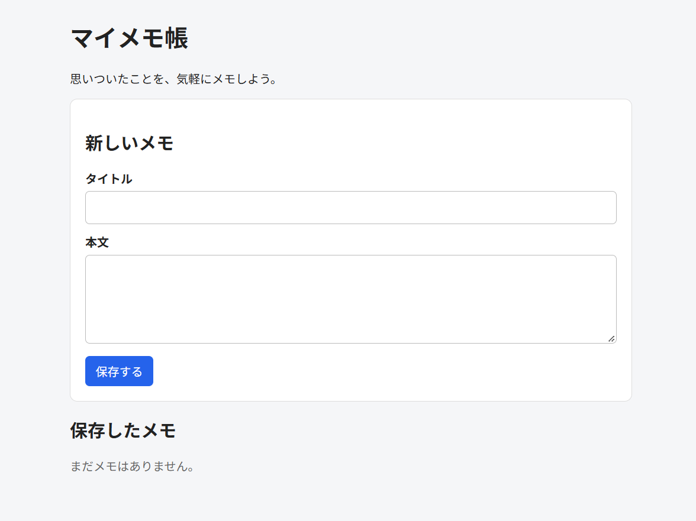

# マイメモ帳（memoapp）

## 概要
JavaとSpring Bootを使用して作成した、ブラウザ上でメモを管理できるWebアプリケーションです。

Javaの学習を目的として、メモの登録・編集・削除やデータベース連携を実装しています。

## アプリ画面



## 使用技術
- Java 21
- Spring Boot
- Spring MVC
- Thymeleaf
- Spring Data JPA
- H2 Database
- Maven

## 主な機能
- メモの新規登録
- 保存したメモの一覧表示
- メモの編集・更新
- メモの削除
- データベースへのメモ保存

## 起動方法

### 必要な環境
- Java 21以上
- Git

### 起動手順
1. リポジトリをクローンします。

```bash
git clone https://github.com/r-oga2024/memoapp.git
```

2. プロジェクトのディレクトリに移動します。

```bash
cd memoapp
```

3. Spring Bootアプリケーションを起動します。

Windowsの場合：

```powershell
.\mvnw.cmd spring-boot:run
```

4. ブラウザで以下のURLにアクセスします。

http://localhost:8081/

## 今後の改善予定
- メモの検索機能
- 入力チェックの追加
- 自動テストの拡充

## 学習目的
Spring Bootを使用したWebアプリケーションの開発、データベース連携、Git・GitHubによるバージョン管理について学習しています。
